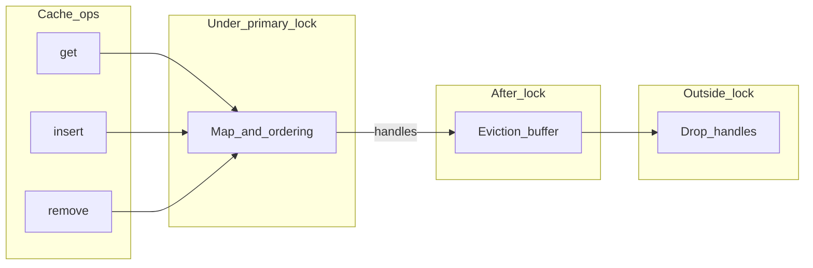

# Clache — design notes (non-normative)

This document captures **implementation intent** for future phases. The **normative** contract is the
public Rust API and doc comments on types and methods.

## Performance targets

- **O(1) worst case** for `**get` / `insert` / `remove`** (including structural work those operations
trigger) is a **target** for a future implementation.
- Time-based eviction driven by the `Policy` trait may remain **lazy** (on access,
opportunistic sweeps, and/or background work) and need not meet the same worst-case bound.

## Capacity and time semantics

- Capacity and time-based cleanups may be **deferred**; there is no guarantee of immediate eviction
on expiry or over-weight.
- `**Policy`** (the `policy` module) is stored on the cache as `CacheConfig::policy`. The cache core
should keep **one deadline per entry** derived from `expire_after_read` / `expire_after_write` and
anchor instants. **TTL- and TTI-style behavior** are obtained by choosing a concrete `Policy`
implementation (e.g. `TtlFromWrite` / `IdleTimeout` wrapping another `Policy`), not by separate built-in TTL/TTI flags on the cache.

## Deferred `Drop` (QuickCache-style)

- Avoid running heavy `**Drop`** while holding the **primary cache lock**.
- After releasing the lock, move evicted or replaced **handles** into a **handoff buffer**; drop
outside the critical section.
- **Enqueue** after the lock should be **cheap and non-blocking** where possible (e.g. a small
dependency with encapsulated `unsafe` for a segment queue, or `std::sync::mpsc` if strict
lock-freedom is relaxed). Draining strategy and bounds are **TBD**.

## Async miss path (`try_get_with`, `get_with`)

- A future implementation must **not** hold the cache’s **synchronous mutex across `.await`**.
Prefer short critical sections and staging (reserve / compute outside / install inside, striping,
etc.).
- `**try_get_with**` returns `Result<V, E>` with `**E: Clone**` (not `Arc<E>`). `**get_with**` uses
`**OkIntoResult<Fut>**` (named future) so the miss path stays `Result<_, Infallible>` without an anonymous `async` block.
- Coalescing lanes may follow moka-style `**(key, TypeId)**` separation: e.g. `**get_with**` vs
`**try_get_with**` vs `**revalidate**` may **not** dedupe with each other unless the design explicitly
unifies those `TypeId` keys.

## Blocking `get_with`

- `Cache::get_with_blocking` uses an internal park-the-thread driver (pollster-style) until the
future completes so callers without an async runtime can still run the initializer on the
current thread. `**get` / `insert` / `remove`** are synchronous only. That driver is not public API.
- Do not use blocking `get_with_blocking` from async worker threads when the initializer may depend on
that same runtime (deadlock risk). Prefer the async miss helpers there.

## Caller-driven `revalidate` (API phase)

- `**Cache::try_revalidate**` / `**Cache::revalidate(key, executor, init)**` schedule a background refresh using an injected
`[Executor](https://docs.rs/hyper/latest/hyper/rt/trait.Executor.html)`-style hook from the
`[rt](../src/rt.rs)` module (same pattern as [hyper’s `Executor](https://docs.rs/hyper/latest/hyper/rt/trait.Executor.html)`).
There is **no** `revalidate_blocking` — refresh is meant to be **spawned**, not park-driven.
`**try_revalidate`** uses `**Result<V, E>**` with `**E: Clone**`; `**revalidate**` delegates to it using `**OkIntoResult<Fut>**` (`Infallible` errors).
- **Phase A (current):** signatures, [`Executor`], [`RevalidateScheduled`](../src/rt.rs), and
  [`RefreshWork`](../src/cache.rs) exist; **`RefreshWork` polls the inner initializer future** so
  executors can drive jobs in tests. [`Cache::try_revalidate`](../src/cache.rs) body is still
  [`todo!()`]: no per-key single-flight or cache map updates yet.
- **Phase B (later):** one in-flight slot per key shared with `**try_get_with` on miss** (per lane); install new
`V` without `remove`-for-refresh; old `V` visible until install. The cache does **not** decide
application staleness — the caller chooses when to call `revalidate` / `try_revalidate`.
- **Bounds:** `get_with` / `try_get_with` initializer futures need **not** be `Send` when you only `.await`
locally (e.g. `LocalSet`). The `revalidate` / `try_revalidate` job passed to `Executor::execute` will typically need
`**Send` + `'static`** for runtimes like `tokio::spawn` once implemented.

## Architecture sketch

## Open questions

- MSRV and `Send` bounds on stored values and initializer futures (`get_with` / `try_get_with` vs `revalidate` / `try_revalidate` split is documented above).
- Whether `get_with` should also expose a bare `Future` builder for external executors beyond
`get_with_blocking`.
- Handoff queue draining and memory bounds if producers outpace consumers.

## Published docs

- The `lib.rs` link to `../docs/DESIGN.md` works in a source checkout; for **docs.rs**, prefer also
linking this file from the repository URL in `Cargo.toml` (`repository` / `homepage`) so readers
can open `DESIGN.md` on GitHub or similar.

