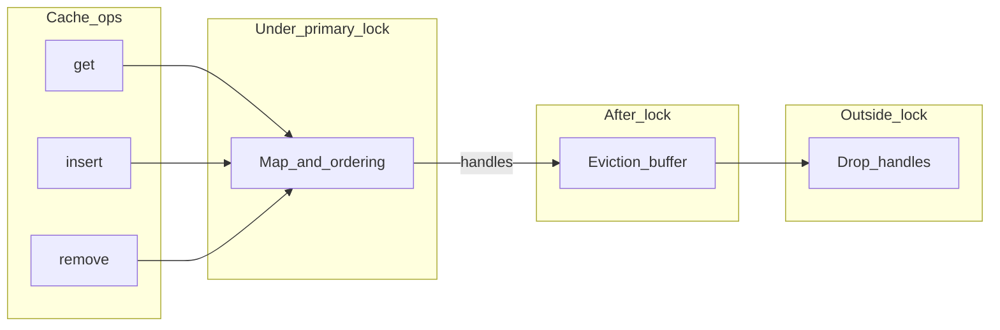

# Clache — design notes (non-normative)

This document captures **non-normative implementation intent** and possible follow-ups. The **normative** contract is the
public Rust API and doc comments on types and methods.

## Performance targets

The aim is **bounded** worst-case work per `get` / `insert` / `remove`. Where a true
**O(1)** structure is impractical, **O(log n)** is acceptable. **O(n)** hot paths
are not — in particular [`evict_until_fit`](../src/cache/inner.rs)'s ready-key
collect must go.

| Piece                                       | Cost                                                        |
| ------------------------------------------- | ----------------------------------------------------------- |
| `get_served` / `insert` / `remove` map ops  | **O(1)** average, **bounded** worst case (incremental resize) |
| Heap deadline maintenance (push / pop)      | **O(log n)**                                                |
| Drain `d` already-expired entries           | **O(d log n)**                                              |
| Slab eviction step (per live victim)        | **O(1)**                                                    |
| Read-deadline update (heap re-push, lazy)   | **O(log n)** amortised; stale entries discarded on peek     |
| Capacity check                              | **O(1)** (running `total_weight` of `Ready` slots)          |

**Capacity flow on writes:** drain entries already past their materialised
deadline first (via the expiry index), then evict live entries via the slab
(LRU or S3-FIFO) until projected weight fits. The expiry index is **only** for
past-deadline reclaim — it is **not** consulted to pick capacity victims by
soonest *future* expiry.

Time-based eviction is otherwise opportunistic (lazy on access plus the drain
above on writes). It is **not** guaranteed to fire immediately at deadline.

## Capacity and time semantics

- Capacity and time-based cleanups may be **deferred**; there is no guarantee of immediate eviction
on expiry or over-weight.
- `**Policy`** (the `policy` module) is stored on the cache as `CacheConfig::policy`. The cache keeps **one deadline per entry** derived from `expire_after_write` on install and from `expire_after_read` **only after** a confirmed live hit (materialized deadline gates `get`; the read hook updates the next deadline). **TTL- and TTI-style behavior** come from concrete `Policy` implementations (e.g. `TtlFromWrite` / `IdleTimeout` wrapping another `Policy`), not separate built-in TTL/TTI flags on the cache.

## Deferred `Drop` (QuickCache-style)

- Avoid running heavy `**Drop`** while holding the **primary cache lock**.
- After releasing the lock, move evicted or replaced **handles** into a **handoff buffer**; drop
outside the critical section. **Implemented today** for size evictions and for **replace** / **refresh**
displaced values (previous `V` is dropped after the lock is released). A larger bounded handoff queue remains optional if producer pressure ever requires it.
- **Enqueue** after the lock should be **cheap and non-blocking** where possible (e.g. a small
dependency with encapsulated `unsafe` for a segment queue, or `std::sync::mpsc` if strict
lock-freedom is relaxed). Draining strategy and bounds are **TBD**.

## Async miss path (`try_get_with`, `get_with`)

- The implementation must **not** hold the cache’s **synchronous mutex across `.await`**.
Prefer short critical sections and staging (reserve / compute outside / install inside, striping,
etc.).
- `**try_get_with**` returns `Result<V, E>` with `**E: Clone**` (not `Arc<E>`). `**get_with**` uses
`**OkIntoResult<Fut>**` (named future) so the miss path stays `Result<_, Infallible>` without an anonymous `async` block.
- Coalescing lanes may follow moka-style `**(key, TypeId)**` separation: e.g. `**get_with**` vs
`**try_get_with**` vs `**revalidate**` may **not** dedupe with each other unless the design explicitly
unifies those `TypeId` keys.

## Blocking `get_with`

- `Cache::get_with_blocking` uses **[pollster](https://github.com/zesterer/pollster)** **0.4.0**
`block_on` (condvar-backed wait) **inlined** in the `blocking` module.
Until the future completes, callers without an async runtime can still run the initializer on the
current thread. `**get` / `insert` / `remove`** are synchronous only. That driver is not public API.
- Do not use blocking `get_with_blocking` from async worker threads when the initializer may depend on
that same runtime (deadlock risk). Prefer the async miss helpers there.

## Caller-driven `revalidate`

- `**Cache::try_revalidate**` / `**Cache::revalidate(key, executor, init)**` schedule a background refresh using an injected
`[Executor](https://docs.rs/hyper/latest/hyper/rt/trait.Executor.html)`-style hook from the
`[rt](../src/rt.rs)` module (same pattern as [hyper’s `Executor](https://docs.rs/hyper/latest/hyper/rt/trait.Executor.html)`).
There is **no** `revalidate_blocking` — refresh is meant to be **spawned**, not park-driven.
`**try_revalidate`** uses `**Result<V, E>**` with `**E: Clone**`; `**revalidate**` delegates to it using `**OkIntoResult<Fut>**` (`Infallible` errors).
- **Implemented:** [`Executor`], [`RevalidateScheduled`](../src/rt.rs), and [`RefreshWork`](../src/cache/mod.rs); per-key
  `refresh_inflight` prevents overlapping refresh jobs for the same key. **`RefreshWork`** is a [`Future`](https://doc.rust-lang.org/std/future/trait.Future.html) that polls the initializer and applies a successful value via `apply_refresh_ok`.
- **Miss vs refresh:** `**try_get_with**` miss coalescing and `**try_revalidate**` use separate coordination; they do not assume a unified `(key, TypeId)` lane unless you explicitly unify them later.
- **Possible follow-up:** unify or further coordinate miss and refresh lanes; install refreshed `V` without a full `remove`-for-refresh while keeping old `V` visible until install. The cache does **not** decide application staleness — the caller chooses when to call `revalidate` / `try_revalidate`.
- **Bounds:** `get_with` / `try_get_with` initializer futures need **not** be `Send` when you only `.await`
locally (e.g. `LocalSet`). The `revalidate` / `try_revalidate` job passed to `Executor::execute` will typically need
`**Send` + `'static`** for runtimes like `tokio::spawn`.

## Architecture sketch




## Benchmark runbook

clache's perf claims are validated by **comparative** benches: every workload
is run against `moka` and `quick_cache` on the same inputs.

### Microbenches (Criterion)

[`benches/compare_cache.rs`](../benches/compare_cache.rs) defines three
scenarios (`get_hit`, `insert_churn` varying *N*, `insert_cold`). Each
`BenchmarkId` carries the implementation tag so `target/criterion/<scenario>/<impl>/<param>/`
groups clache, moka, and quick_cache side-by-side.

```sh
cargo bench --bench compare_cache
cargo bench --bench compare_cache -- --quick get_hit   # smoke run
```

### Trace-driven (mokabench fork)

Upstream `moka-rs/mokabench` exposes `CacheDriver` only as `pub(crate)`, so a
new backend cannot be added without modifying the crate. We carry an in-tree
fork at `third-party/mokabench` (branch `add-clache-driver` on
`conradludgate/mokabench`) that adds the `clache` feature, a
`cache::clache::ClacheCache` driver, and `run_multi_threads_clache`.

[`examples/mokabench_compare.rs`](../examples/mokabench_compare.rs) drives the
three sync backends on identical traces, e.g.:

```sh
git submodule update --init --recursive third-party/mokabench
zstd -d -k third-party/mokabench/cache-trace/arc/OLTP.lis.zst
cargo run --release --example mokabench_compare -- oltp
```

The `cache-trace` files ship as `.zst`; decompress the ones you need before
running. TTL/TTI traces are **not yet wired** through the clache driver and
will `todo!()` until that work lands.

### Frozen pre-refactor baseline

Before any cache-algorithm changes we captured a baseline at the
`bench-pre-refactor` git tag. The archive lives in
[`bench-baselines/pre-refactor/`](../bench-baselines/pre-refactor/) (Criterion
tree, flat `criterion-summary.txt`, mokabench OLTP log, `BASELINE.txt`
provenance). To diff later work against it:

```sh
# Restore Criterion tree if target/ was cleaned.
cp -R bench-baselines/pre-refactor/criterion/* target/criterion/
cargo bench --bench compare_cache -- --baseline pre_refactor
```

A regression in the comparative slope (especially `insert_churn` vs *N*) is
the primary signal — Criterion's per-bench diff is supporting evidence.

## Open questions

- **`Send` bounds** on stored values and initializer futures (`get_with` / `try_get_with` vs `revalidate` / `try_revalidate` split is documented above).
- **Bare `Future` for `get_with` (beyond `get_with_blocking`):** left **open**. Bias **against** adding a detached miss future: callers can **drop it without polling**, which risks stranded in-flight work or surprising behavior for other waiters on the same key. Prefer **`async fn get_with`** plus **`get_with_blocking`** unless a concrete integration needs a third path.
- **Handoff queue bounds:** only becomes important if you add a **persistent** async drain or unbounded producer pressure on a deferred-drop queue. Until then, note “not applicable” for the current immediate `Vec` handoff after each operation.

**MSRV:** **1.95** (declared in `Cargo.toml` as `rust-version`).

## Published docs

- The `lib.rs` link to `../docs/DESIGN.md` works in a source checkout; for **docs.rs**, prefer also
linking this file from the repository URL in `Cargo.toml` (`repository` / `homepage`) so readers
can open `DESIGN.md` on GitHub or similar.

