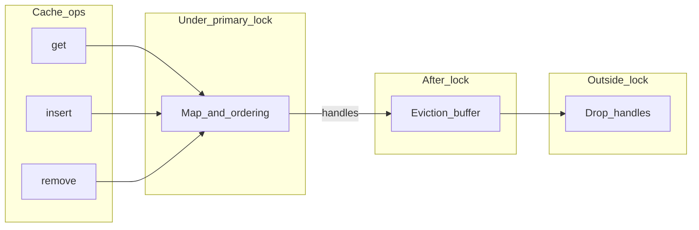

# Clache — design notes (non-normative)

This document captures **non-normative implementation intent** and possible follow-ups. The **normative** contract is the
public Rust API and doc comments on types and methods.

## Performance targets

The aim is **bounded** worst-case work per `get` / `insert` / `remove`. Where a true
**O(1)** structure is impractical, **O(log n)** is acceptable. **O(n)** hot paths
are not — in particular [`evict_until_fit`](../src/cache/inner.rs)'s ready-key
collect must go.

| Piece                                       | Cost                                                        |
| ------------------------------------------- | ----------------------------------------------------------- |
| `get_served` / `insert` / `remove` map ops  | **O(1)** average, no rehash spikes inside the weight budget |
| Heap deadline maintenance (push / pop)      | **O(log n)**                                                |
| Drain `d` already-expired entries           | **O(d log n)**                                              |
| Slab eviction step (per live victim)        | **O(1)**                                                    |
| Read-deadline update (heap re-push, lazy)   | **O(log n)** amortised; stale entries discarded on peek     |
| Capacity check                              | **O(1)** (running `total_weight` of `Ready` slots)          |

Map sizing: `State.entries` is constructed with `HashMap::with_capacity(min(max_weight, 1 << 20))` so a cache that stays inside its weight budget never sees a rehash. Past that cap (or with `Weight::ZERO` policies) the standard amortised-doubling growth applies. A `papaya::HashMap` with `ResizeMode::Incremental` was considered for hard worst-case bounds; under the current `Mutex<State>` it would force a clone on every `update_read_deadline` for no reader-concurrency benefit, so it is deferred until Phase 3 lifts the outer mutex.

**Capacity flow on writes:** drain entries already past their materialised
deadline first (via the expiry index), then evict live entries via the
S3-FIFO size loop (see **Eviction: S3-FIFO** below) until projected weight
fits. The expiry index is **only** for past-deadline reclaim — it is **not**
consulted to pick capacity victims by soonest *future* expiry.

Time-based eviction is otherwise opportunistic (lazy on access plus the drain
above on writes). It is **not** guaranteed to fire immediately at deadline.

## Eviction: S3-FIFO

Each shard keeps two intrusive FIFOs and a bounded fingerprint set instead
of a single LRU list (Yang et al., *FIFO queues are all you need for cache
eviction*, SOSP'23):

- **`small: Fifo`** — newly inserted entries land at the head and age toward
  the tail. Sized at `shard_max_weight / SMALL_DENOMINATOR` (V1: `S = 10`).
  Overflow drains via `evict_from_small`.
- **`main: Fifo`** — slots that survived a Small-tail promotion or were
  reinstalled while their fingerprint sat in `ghost`. Drains via
  `evict_from_main` only when Small is at or under its share of the budget.
- **`ghost: GhostSet`** — bounded `VecDeque<u64>` + `HashTable<u64>` ring of
  fingerprints (`hash_key` outputs) recently evicted from Small with
  `freq <= 1`. The install path consumes membership (`ghost.remove(fp)`)
  to route a returning key directly into Main. Capacity is an entry-count
  proxy: `capacity_hint_from_max_weight(shard_max_weight)` (one `u64` per
  ghost slot, bounded to `min(2^20, shard_max_weight)` per shard).
- **`small_weight: u64`** — running sum of `Policy::weight` over slots
  currently in Small. The reclaim outer loop drains Small first when
  `small_weight > shard_max_weight / SMALL_DENOMINATOR`, otherwise Main.

Each [`EntrySlot`](../src/cache/inner.rs) carries a `queue: Queue` discriminant
(`Small` or `Main`), a saturating `freq: u8` (capped at `FREQ_CAP = 3`),
and a single `(fifo_prev, fifo_next)` pair — a slot is in exactly one
queue at a time, so one link pair is enough to thread it through whichever
queue currently owns it.

**Read paths.** `get_served` and the hit branch of `with_probe_for_hit`
bump the slot's `freq` (saturating at `FREQ_CAP`) and **do not** touch
queue order. Read paths still take the shard's `.write()` lock: `freq` is
a plain `u8` (not atomic), and read-extending policies (`IdleTimeout`,
custom `expire_after_read`) still mutate `entry.deadline` and push a fresh
expiry tuple. Lifting the read path to a `.read()` lock would require
both an atomic `freq` and a lock-free expiry-heap push, which V1 does not
deliver — pure read-only views (`contains_key`, `len`, `is_empty`,
`weight`) already take `.read()`.

**Reclaim loop.** With `displaced_weight` for the slot being replaced
already hoisted, each iteration tries the prescribed queue and falls back
to the other when the prescribed one is empty:

```text
while total_weight - displaced + add_w > shard_max_weight:
    if small_weight > shard_max_weight / SMALL_DENOMINATOR:
        evict_from_small()    # promote (freq>1) | evict + ghost.insert(fp) (freq<=1)
    else:
        evict_from_main()     # recirculate (freq>0, dec freq) | evict (freq=0)
```

Termination: every `evict_from_main` recirculation decrements `freq`, so
each Main slot is touched at most `FREQ_CAP + 1` times before being forced
to `freq = 0` and dropped. `evict_from_small` either promotes one slot
(after which it lives in Main and never reappears in Small) or evicts.
Both bounds are `O(small.len() + (FREQ_CAP + 1) * main.len())` per outer
iteration.

**Skip-key invariant.** Both `evict_from_small` and `evict_from_main`
short-circuit when the queue's tail key equals `skip_key` (the entry the
caller is currently installing or replacing): the would-be victim is
rotated to its current queue's head and the outer loop iterates with a
different victim. The `slab.len() <= 1` guard breaks the loop when only
the skip slot remains, allowing oversized solo replacements to complete
even if they leave the cache temporarily over budget.

**Ghost population, narrowed.** Only `evict_from_small` low-`freq`
evictions seed `ghost`. `evict_from_main` evictions and every other
`evict_slot` caller (`drain_expired` for TTL, user-driven
`Inner::insert` / `apply_refresh_ok` / `finish_miss_ok` replacements,
`Inner::remove`) deliberately do **not** add to ghost — only "recently
popular but evicted from Small under capacity pressure" is the signal
that justifies a second-chance Main install on reinsert.

## Capacity and time semantics

- Capacity and time-based cleanups may be **deferred**; there is no guarantee of immediate eviction
on expiry or over-weight.
- `**Policy`** (the `policy` module) is stored on the cache as `CacheConfig::policy`. The cache keeps **one deadline per entry** derived from `expire_after_write` on install and from `expire_after_read` **only after** a confirmed live hit (materialized deadline gates `get`; the read hook updates the next deadline). **TTL- and TTI-style behavior** come from concrete `Policy` implementations (e.g. `TtlFromWrite` / `IdleTimeout` wrapping another `Policy`), not separate built-in TTL/TTI flags on the cache.

## Deferred `Drop` (QuickCache-style)

- Avoid running heavy `**Drop`** while holding the **primary cache lock**.
- After releasing the lock, move evicted or replaced **handles** into a **handoff buffer**; drop
outside the critical section. **Implemented today** for size evictions and for **replace** / **refresh**
displaced values (previous `V` is dropped after the lock is released). A larger bounded handoff queue remains optional if producer pressure ever requires it.
- **Enqueue** after the lock should be **cheap and non-blocking** where possible (e.g. a small
dependency with encapsulated `unsafe` for a segment queue, or `std::sync::mpsc` if strict
lock-freedom is relaxed). Draining strategy and bounds are **TBD**.

## Async miss path (`try_get_with`, `get_with`)

- The implementation must **not** hold the cache’s **synchronous mutex across `.await`**.
Prefer short critical sections and staging (reserve / compute outside / install inside, striping,
etc.).
- `**try_get_with**` returns `Result<V, E>` with `**E: Clone**` (not `Arc<E>`). `**get_with**` uses
`**OkIntoResult<Fut>**` (named future) so the miss path stays `Result<_, Infallible>` without an anonymous `async` block.
- Coalescing lanes may follow moka-style `**(key, TypeId)**` separation: e.g. `**get_with**` vs
`**try_get_with**` vs `**revalidate**` may **not** dedupe with each other unless the design explicitly
unifies those `TypeId` keys.

## Sync miss-coalescing

- `Cache::get_or_insert_with` is the sync counterpart to `get_with`. It single-flights through
the same per-shard `inflight` map as `try_get_with`/`get_with`, but each lane carries a Condvar-backed
`SyncMissFlight<V>` instead of a `tokio::sync::watch`. The shard `RwLock` is dropped before the user
closure runs, so other keys remain responsive while one key's leader produces a value.
- Sync and async lanes share the same `inflight: HashMap<(K, TypeId), InflightLane>` map. Each
`(key, TypeId<F>)` pair indexes at most one leader; the `TypeId<F>` half of the key carries the
`Flight` discrimination (`MissFlight<V, E>` for `try_get_with`, `SyncMissFlight<V>` for
`get_or_insert_with`). A sync caller never joins an async leader (and vice versa); both kinds run
their own `init` if no compatible follower is found. There is no sentinel marker type: the concrete
`TypeId<F>` *is* the distinction. Borrowed lookups go through a `LaneKeyRef<'a, K>` adapter that
implements `Equivalent<(K, TypeId)>`, so `&K` probes do not clone the key.
- Do not call `get_or_insert_with` from a Tokio worker thread if the closure would itself block on
that runtime — the current-thread block is a hard wait; prefer the async miss helpers there.

## Typed lanes

Miss coalescing splits flights by `(K, TypeId<F>)` where `F` is the concrete in-flight type:

- `MissFlight<V, E>` for each error type `E` used by `try_get_with` callers. Two `try_get_with`
  calls on the same key but with different `E` types do not share a leader — each runs its own
  `init` and returns its own `Result<V, E>`. This avoids forcing a common error supertype across
  unrelated callers and matches `moka`'s typed miss lanes.
- `SyncMissFlight<V>` for `get_or_insert_with`. Sync lanes coexist with the async ones; the
  `Flight` trait is the cancel-on-leader-drop interface (`watch::Sender::send(Cancelled)` for
  async, Condvar `notify_all` for sync) so cross-shard cancel paths (`clear`, future cancel-all)
  do not need to know which kind of flight they are tearing down.

Lane install / follower-join is centralised in `install_or_join_lane::<F>(state, key)`; the
read-side hit-detection (drain expired, freq bump, push read-side expiry) is centralised in
`Inner::with_probe_for_hit`. `Inner::miss_probe::<F>` glues both together inside one shard
critical section so there is no TOCTOU window between hit detection and lane install.

## Cross-shard `clear`

`Cache::clear` walks `Inner::shards` in deterministic index order (`for shard in &self.shards`).
Per shard:

1. Take the shard's write lock.
2. Drain `main` tail-to-head into a `Vec<(K, V)>`, then drain `small`
   tail-to-head into the same vec.
3. Reset entries map, expiry heap, stale-push counter, total weight,
   `small_weight`, and clear the ghost set.
4. Drain the in-flight lanes into a side vec.
5. Release the shard lock.
6. Cancel every drained `InflightLane` so any waiting follower returns `None` from `wait` /
   `await_settled` and re-enters its probe loop.
7. Fire `LifecycleReason::Removed` for each drained entry, in step 2's
   order (Main tail-to-head, then Small tail-to-head).

Implications callers can rely on:

- `Removed` callbacks for keys in shard *i* fire before any callback for keys in shard *j > i*.
- Within a shard, callback order is "Main before Small, both tail-to-head"
  — an implementation detail today (S3-FIFO has no global recency axis,
  so it deliberately does not promise an LRU-style "oldest first"), but
  the cross-shard ordering above is the load-bearing invariant for tests
  and observers.
- `clear` does not block follower threads waiting on cancelled lanes — they see the cancel signal
  and re-probe, so a `clear` that races a `try_get_with` is safe even when the cleared key is the
  one being initialised. The same shape is what makes
  `clear_during_inflight_try_revalidate_does_not_wedge_flag` pass: the slot owning
  `refresh_inflight` is evicted along with the rest, so the next `try_revalidate` sees a fresh
  shard.

## Caller-driven `revalidate`

- `**Cache::try_revalidate**` / `**Cache::revalidate(key, executor, init)**` schedule a background refresh using an injected
`[Executor](https://docs.rs/hyper/latest/hyper/rt/trait.Executor.html)`-style hook from the
`[rt](../src/rt.rs)` module (same pattern as [hyper’s `Executor](https://docs.rs/hyper/latest/hyper/rt/trait.Executor.html)`).
There is **no** `revalidate_blocking` — refresh is meant to be **spawned**, not park-driven.
`**try_revalidate`** uses `**Result<V, E>**` with `**E: Clone**`; `**revalidate**` delegates to it using `**OkIntoResult<Fut>**` (`Infallible` errors).
- **Implemented:** [`Executor`], [`RevalidateScheduled`](../src/rt.rs), and [`RefreshWork`](../src/cache/mod.rs); per-key
  `refresh_inflight` prevents overlapping refresh jobs for the same key. **`RefreshWork`** is a [`Future`](https://doc.rust-lang.org/std/future/trait.Future.html) that polls the initializer and applies a successful value via `apply_refresh_ok`.
- **Miss vs refresh:** `**try_get_with**` miss coalescing and `**try_revalidate**` use separate coordination; they do not assume a unified `(key, TypeId)` lane unless you explicitly unify them later.
- **Possible follow-up:** unify or further coordinate miss and refresh lanes; install refreshed `V` without a full `remove`-for-refresh while keeping old `V` visible until install. The cache does **not** decide application staleness — the caller chooses when to call `revalidate` / `try_revalidate`.
- **Bounds:** `get_with` / `try_get_with` initializer futures need **not** be `Send` when you only `.await`
locally (e.g. `LocalSet`). The `revalidate` / `try_revalidate` job passed to `Executor::execute` will typically need
`**Send` + `'static`** for runtimes like `tokio::spawn`.

## Architecture sketch




## Benchmark runbook

clache's perf claims are validated by **comparative** benches: every workload
is run against `moka` and `quick_cache` on the same inputs.

### Microbenches (Criterion)

[`benches/compare_cache.rs`](../benches/compare_cache.rs) defines three
scenarios (`get_hit`, `insert_churn` varying *N*, `insert_cold`). Each
`BenchmarkId` carries the implementation tag so `target/criterion/<scenario>/<impl>/<param>/`
groups clache, moka, and quick_cache side-by-side.

```sh
cargo bench --bench compare_cache
cargo bench --bench compare_cache -- --quick get_hit   # smoke run
```

### Trace-driven (mokabench fork)

Upstream `moka-rs/mokabench` exposes `CacheDriver` only as `pub(crate)`, so a
new backend cannot be added without modifying the crate. We carry an in-tree
fork at `third-party/mokabench` (branch `add-clache-driver` on
`conradludgate/mokabench`) that adds the `clache` feature, a
`cache::clache::ClacheCache` driver, and `run_multi_threads_clache`.

[`examples/mokabench_compare.rs`](../examples/mokabench_compare.rs) drives the
three sync backends on identical traces, e.g.:

```sh
git submodule update --init --recursive third-party/mokabench
zstd -d -k third-party/mokabench/cache-trace/arc/OLTP.lis.zst
cargo run --release --example mokabench_compare -- oltp
```

The `cache-trace` files ship as `.zst`; decompress the ones you need before
running. TTL/TTI traces are **not yet wired** through the clache driver and
will `todo!()` until that work lands.

### Frozen baselines

Two endpoints are archived so future work can diff against either side
of the Phase 2 refactor:

- [`bench-baselines/pre-refactor/`](../bench-baselines/pre-refactor/) —
  captured at the `bench-pre-refactor` tag, before the slab + LRU + heap
  engine landed. Includes `BASELINE.txt`, the Criterion tree (with the
  `pre_refactor` baseline), `criterion-summary.txt`, and `mokabench/oltp.log`.
- [`bench-baselines/post-refactor/`](../bench-baselines/post-refactor/) —
  captured immediately after Phase 2 on the same machine. Includes
  `POST_REFACTOR.md` (deltas + provenance), the Criterion tree (with both
  `pre_refactor` and `post_refactor` baselines persisted side-by-side),
  and `mokabench/oltp.log`.

Diff against either endpoint:

```sh
cp -R bench-baselines/post-refactor/criterion/* target/criterion/
cargo bench --bench compare_cache -- --baseline pre_refactor   # vs Phase 0
cargo bench --bench compare_cache -- --baseline post_refactor  # vs Phase 2
```

A regression in the comparative slope (especially `insert_churn` vs *N*) is
the primary signal — Criterion's per-bench diff is supporting evidence.

## Open questions

- **`Send` bounds** on stored values and initializer futures (`get_with` / `try_get_with` vs `revalidate` / `try_revalidate` split is documented above).
- **Bare `Future` for `get_with`:** left **open**. Bias **against** adding a detached miss future: callers can **drop it without polling**, which risks stranded in-flight work or surprising behavior for other waiters on the same key. Prefer **`async fn get_with`** plus **`get_or_insert_with`** unless a concrete integration needs a third path.
- **Handoff queue bounds:** only becomes important if you add a **persistent** async drain or unbounded producer pressure on a deferred-drop queue. Until then, note “not applicable” for the current immediate `Vec` handoff after each operation.

**MSRV:** **1.95** (declared in `Cargo.toml` as `rust-version`).

## Published docs

- The `lib.rs` link to `../docs/DESIGN.md` works in a source checkout; for **docs.rs**, prefer also
linking this file from the repository URL in `Cargo.toml` (`repository` / `homepage`) so readers
can open `DESIGN.md` on GitHub or similar.

